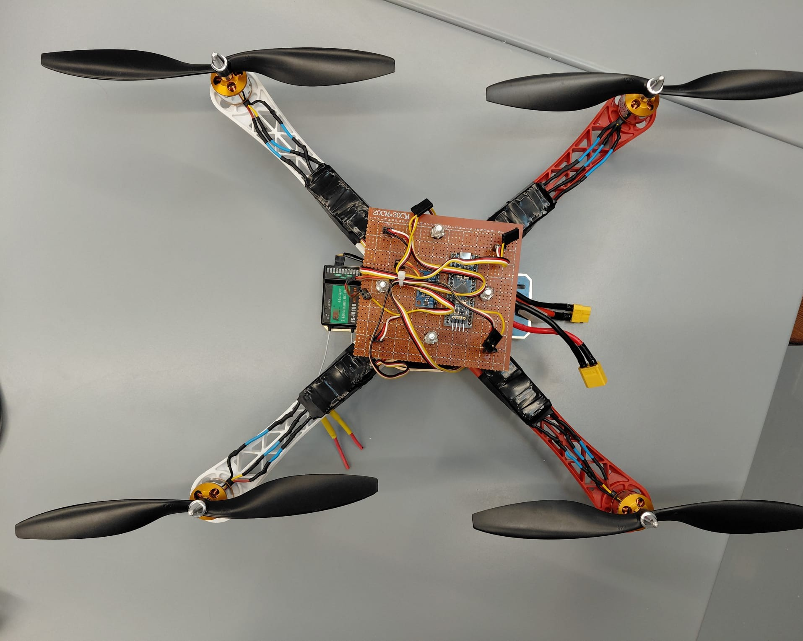
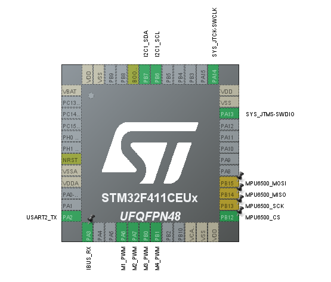

# STM32 Quadcopter Flight Controller

**English** | [Türkçe](README.tr.md)

Quadcopter flight control firmware I wrote from scratch in C with STM32 HAL,
running on an STM32F411CEU6 (Black Pill).



> The project is still under development; code and settings may change.

## Features

- Angle mode: roll/pitch hold the angle set by the stick (±15°), the yaw stick
  sets the rotation rate (60 °/s)
- 100 Hz control loop: RC input → IMU → complementary filter → PID → X mixer → ESCs
- MPU6500 IMU (SPI); the accelerometer contributes to the angle only while it
  reads ~1 g
- FlySky iBUS receiver, 400 Hz ESC PWM
- Safety: arming conditions, motor stop on RC signal loss, IMU error tolerance,
  watchdog (IWDG)

## Hardware

| Part | Used |
|---|---|
| Microcontroller | STM32F411CEU6 "Black Pill" |
| IMU | MPU6500 module (SPI) |
| Transmitter / receiver | FlySky FS-i6X / FS-iA10B (iBUS) |
| ESC | 4 × Hobbywing Skywalker 30A V2 |
| Motor / propeller | 4 × A2212 1000KV / 1047 |
| Battery | 3S LiPo |

## Pin connections



PB13–PB15 appear yellow because SPI2 is set up in code (`mpu6500.c`), not in
CubeMX. PB6/PB7 (I2C1) are reserved for an optional I2C IMU; PA2 is unused.

| Pin | Function | Connection |
|---|---|---|
| PA6 / PA7 / PB0 / PB1 | TIM3 CH1–CH4 | M1 / M2 / M3 / M4 ESC |
| PA3 | USART2_RX | FS-iA10B iBUS |
| PB12 / PB13 / PB14 / PB15 | SPI2 (CS / SCK / MISO / MOSI) | MPU6500 (NCS / SCL / AD0 / SDA on the module) |

```
       front
   M1 (CW)   M2 (CCW)
        \     /
         \   /
         /   \
        /     \
  M3 (CCW)   M4 (CW)
```

RC channels (Mode 2): CH1 roll, CH2 pitch, CH3 throttle, CH4 yaw, CH5 arm.

## Building

Builds with STM32CubeIDE 1.19 (*File → Import → Existing Projects into
Workspace*). SPI2, the watchdog and the 96 MHz clock are configured in code
rather than in CubeMX, so SPI2 mode is left disabled in CubeMX.

## Known limitations

- Angle mode only; no acro (rate) mode.
- Yaw controls only the rotation rate and does not hold heading: if an external
  disturbance turns the drone, it does not return to its previous heading.
  Small gyro zero drift can cause a slow rotation, which is corrected with the
  transmitter's yaw trim.
- No altitude hold, GPS or telemetry yet.
- Battery voltage is not measured; there is no low-battery warning.
- The drone must stay still during the gyro calibration at power-up (~10 s).

## Axes and settings

- **Axis directions:** roll + right side down, pitch + nose up, yaw + clockwise
  seen from above. The IMU module is mounted with X forward, Y left and Z up
  (axis mapping in `imu_filter.c`).
- **Motor response:** when the drone tilts, the motors on the lower side speed
  up; yaw is corrected by the speed difference between the CW and CCW motor
  pairs.
- **Level offset:** the angle the sensor reads while the drone is level
  (`IMU_LEVEL_*_OFFSET_DEG`, `main.c`); specific to the frame and the sensor
  mounting.
- **Tuning values:** PID gains are in `main.c`, the maximum angle and yaw rate
  in `rc_input.h`, and the RC channel ranges in `rc_input.c`; all of them are
  tuned for my drone.

## Project structure

```
Core/Src/main.c                control loop, initialization, arming, safety
Core/Src/mpu6500.c             IMU driver
Core/Src/imu_filter.c          complementary filter
Core/Src/pid_controller.c      PID
Core/Src/motor_control.c       arming checks, X mixer
Core/Src/esc_pwm.c             ESC PWM
Core/Src/ibus_receiver.c       iBUS receiver
Core/Src/rc_input.c, rc_arm.c  RC inputs, arm/disarm
Core/Src/flight_diagnostics.c  vibration and loop statistics
```

## Planned

- Moving to the PCB I designed
- Battery voltage measurement and low-battery warning
- Altitude hold with a barometer (BME280)
- HC-12 telemetry and GPS

## License

[MIT](LICENSE). The STM32 HAL and CMSIS files under `Drivers/` are owned by
STMicroelectronics and covered by their own licenses.
